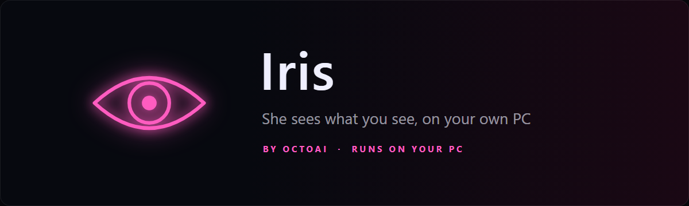

<p align="center">
  
</p>

<p align="center">
  <a href="https://github.com/Khan-Doruk/iris-releases/releases/latest"></a>
  <a href="https://github.com/Khan-Doruk/iris-releases/releases"></a>
  
  
</p>

<p align="center">
  <a href="https://github.com/Khan-Doruk/iris-releases/releases/latest/download/IrisSetup.exe"><b>Download Iris for Windows</b></a>
  &nbsp;·&nbsp;
  <a href="https://github.com/Khan-Doruk/iris-releases/releases">Release notes</a>
  &nbsp;·&nbsp;
  <a href="https://ai.octoman.io">ai.octoman.io</a>
</p>

---

Iris looks at your screen and tells you what's on it. She describes what's open, reads text word for word, explains errors and compares before and after. She floats in a small panel over your work; press **LOOK**, or just ask. The AI models run on your own machine through [Ollama](https://ollama.com), so your screen stays with you.

## What Iris does

| | |
|---|---|
| **Looks at your screen** | Press LOOK, or ask "what's on my screen?", and she describes what's open. Drag over part of the screen with REGION to ask about just that. |
| **Reads text exactly** | TEXT reads what's on screen word for word, with a text reader that runs on your PC, and can put it on your clipboard. |
| **Explains errors** | "What does this error mean?" She reads it and tells you how to fix it. |
| **Before and after** | Save the screen, change something, and ask what changed. |
| **Talk to her** | Press `Ctrl+Shift+I` or click the mic and just talk. She answers out loud, and you can reply without pressing anything or talk over her. |
| **Memory** | She remembers what you ask her to. See and delete everything in Settings. |
| **Works with Orion** | With [Orion](https://github.com/Khan-Doruk/orion-releases) on the same PC, he can ask Iris about your screen, and she can ask him the time, the weather or your reminders. |

### Try saying

```text
What's on my screen?
Read the screen
What does this error mean?
Look at this region
Save before
Compare screens
```

## Getting started

1. **Download** [`IrisSetup.exe`](https://github.com/Khan-Doruk/iris-releases/releases/latest/download/IrisSetup.exe) and run it. No administrator rights needed.
2. If Windows shows **"Windows protected your PC"**, click **More info**, then **Run anyway**. The installer isn't code-signed yet.
3. Setup installs **Ollama**, the local AI engine, if it's missing or out of date (about 1.6 GB). If you have Orion, Iris uses the same one.
4. On first start, enter your **product key**. Iris is in testing with a small group, and keys are handed out to testers.
5. Iris gets ready: she downloads **llava**, the model she sees with (about 4.7 GB), and an AI model for her answers unless your PC already has one from Orion. This happens once.

## Requirements

| | |
|---|---|
| **System** | Windows 10 or 11, 64-bit |
| **Graphics card** | An NVIDIA card with 8 GB of memory gives the best answers and the fastest hearing. Smaller cards, and PCs without one, get a smaller model and run slower. |
| **Disk space** | About 17 GB (Iris, Ollama, llava and the largest answer model together); about 6 GB more if Orion is already installed |
| **Microphone** | Optional. You can type everything too. |
| **Internet** | For setup and the model downloads. After that Iris works offline. |

**Which answer model you get**

| Graphics memory | Model | Download |
|---|---|---|
| 8 GB or more | qwen3.5:9b | about 6.6 GB |
| 4 to 8 GB | qwen3.5:4b | about 3.3 GB |
| Less, or no NVIDIA card | qwen3.5:2b | about 2.7 GB |

If Orion already downloaded one, Iris uses that.

## Privacy

- **Your screen stays on your PC.** Screenshots are looked at by the models on your machine and kept in memory only while Iris is open. They are never written to disk or uploaded.
- **Your voice stays local.** Speech is turned into text on your PC; no recordings are uploaded.
- **Online only for setup and updates.** The model downloads, and the update check on this page.
- **You're in control of memory.** Everything Iris remembers is listed in Settings, with a forget button for each item.

## Updates

Iris checks this page for new versions and shows a bar with **Install**, **What's new** and **Later**. Every update is checked against a signed list of file hashes before it installs, and it keeps your data, activation and models. Say **"check for updates"** any time.

### Check your download

Each release includes `SHA256SUMS.txt`. In PowerShell, in the folder you downloaded to:

```powershell
Get-FileHash .\IrisSetup.exe -Algorithm SHA256
```

The hash should match the line for `IrisSetup.exe` in `SHA256SUMS.txt`.

## Help

- **Something not working?** Open **EXPAND, Settings, CHECK MY SETUP**. It tests her voice, hearing, text reading, screen capture and AI in one go. **COPY REPORT** gives you a text to send along; it contains no personal data.
- **Shortcut:** `Ctrl+Shift+I` brings Iris up and starts a conversation. **HIDE** puts her in the tray by the clock.
- **Language:** Iris understands and speaks English.
- **Uninstalling:** Windows Settings, Apps, Iris. This removes Iris and her data. It asks before removing Ollama and its models, and suggests keeping them while Orion or Atlas still use them.

---

<p align="center">
  This repository holds Iris's installers and release notes only.<br>
  Iris is made by <a href="https://ai.octoman.io">OctoAI</a>, the AI division of <a href="https://octoman.io">Octoman</a>.
</p>
